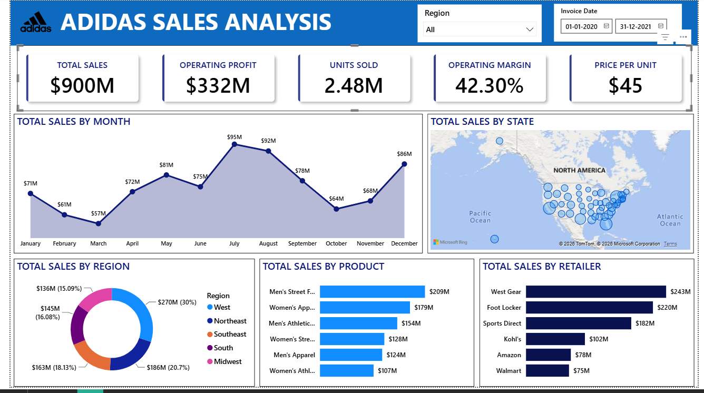

# Adidas US Sales Analysis Dashboard — Power BI

An interactive Power BI dashboard that analyzes Adidas sales in the United States for 2020–2021, by region, state, product, retailer and month.

## About the Project

In this project I analyzed 9,600+ Adidas sales records from the US. I loaded the data into Power BI, set the correct data types in Power Query, and built a one-page dashboard. It answers questions like: Which region sells the most? Which product is the best seller? Which retailer brings the most sales? How do sales change month by month?

## Tools Used

| Tool | Used for |
|---|---|
| Excel | Raw dataset |
| Power Query | Loading data and setting data types |
| Power BI | Dashboard, charts and map |

## Dataset

| Detail | Value |
|---|---|
| Rows (sales records) | 9,648 |
| Time period | Jan 2020 – Dec 2021 |
| Retailers | 6 |
| Regions | 5 |
| States | 50 |
| Cities | 52 |
| Products | 6 |
| Sales methods | 3 (In-store, Outlet, Online) |

**Columns:** Retailer, Retailer ID, Invoice Date, Region, State, City, Product, Price per Unit, Units Sold, Total Sales, Operating Profit, Operating Margin, Sales Method.

The dataset has **no missing values** and **no duplicate rows**.

## Data Preparation (Power Query)

1. Loaded the Excel sheet and promoted the first row to column headers.
2. Set the correct data type for each column:
   - Invoice Date → Date
   - Units Sold, Retailer ID → Whole Number
   - Price per Unit, Total Sales, Operating Profit, Operating Margin → Decimal Number
   - Text columns → Text
3. Used the date hierarchy on **Invoice Date** to show sales by month.

## KPIs

| KPI | Value |
|---|---|
| Total Sales | $900M |
| Operating Profit | $332M |
| Units Sold | 2.48M |
| Operating Margin (average) | 42.3% |
| Price per Unit (average) | $45 |

These values are for **all regions and the full period (2020–2021)**. All KPIs and charts change when you pick a region or a date range in the filters.

> **Note on margin:** 42.3% is the simple average of the margin on each sale. Overall profit ÷ overall sales ($332M ÷ $900M) gives **36.9%**. The second number gives more weight to bigger sales.

## Dashboard Features

- **KPI cards** – Total Sales, Operating Profit, Units Sold, Operating Margin (average), Price per Unit (average)
- **Total Sales by Month** – area chart showing the trend over time
- **Total Sales by Region** – donut chart
- **Total Sales by Product** – bar chart
- **Total Sales by Retailer** – bar chart
- **US Map by State** – bubble size shows sales; tooltip shows profit, margin, units and price
- **Filters** – Region dropdown and Invoice Date range slider

## Key Insights

1. **West is the top region:** $270M, about 30% of total sales.
2. **Men's Street Footwear is the best-selling product:** $209M (23% of sales).
3. **West Gear is the top retailer:** $243M (27%), followed by Foot Locker ($220M).
4. **New York, California and Florida** are the top 3 states, together about 20% of sales.
5. **Sales grew about 4 times from 2020 to 2021:** $182.1M → $717.8M.
6. **July ($95M) and August ($92M)** are the strongest months, and **March ($57M)** is the weakest (2020 and 2021 combined). December also shows a holiday jump ($86M).
7. **In-store** brings the most sales (40%), but **Online** sales have a higher profit margin.
8. The **South** region has the highest margin, even though it is 4th in sales.

## Region View (using the Region filter)

| Region | Total Sales | Top Product | Top Retailer | Avg Margin |
|---|---|---|---|---|
| West | $270M | Men's Street Footwear | West Gear | 39.7% |
| Northeast | $186M | Men's Street Footwear | Foot Locker | 41.0% |
| Southeast | $163M | Men's Street Footwear | Foot Locker | 41.9% |
| South | $145M | Women's Apparel | Sports Direct | 46.7% |
| Midwest | $136M | Men's Street Footwear | Foot Locker | 43.5% |

Men's Street Footwear is the top product in every region except the **South**, where Women's Apparel leads.

## Data Note

In about 3,900 rows, *Total Sales* is 10 times *Price per Unit × Units Sold*. This comes from the original public dataset, so the totals above are based on the *Total Sales* column as given.

## Files in this Repository

| File | Description |
|---|---|
| `Adidas_Sales_Analysis.pbix` | Power BI dashboard file |
| `Adidas_US_Sales_Datasets.xlsx` | Raw dataset |
| `dashboard.png` | Dashboard screenshot |

## How to Open

1. Download or clone this repository.
2. Install **Power BI Desktop** (free) from Microsoft.
3. Open `Adidas_Sales_Analysis.pbix`.
4. If Power BI cannot find the data, go to **Transform data → Data source settings → Change Source** and select `Adidas_US_Sales_Datasets.xlsx` from the downloaded folder.

## Author

**Pawan Jangid** – MCA (Cyber Security), JECRC University
[LinkedIn](https://www.linkedin.com/in/pawanjangid7799/) · [GitHub](https://github.com/Pawanjangid4424)# Adidas-US-Sales-Analysis-PowerBI
